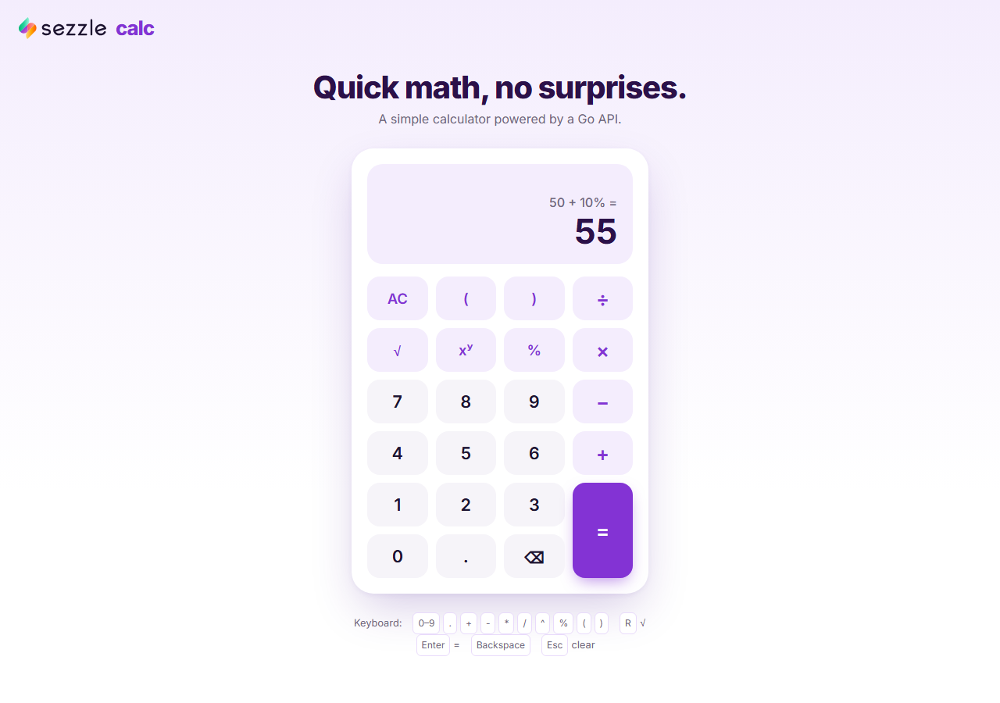
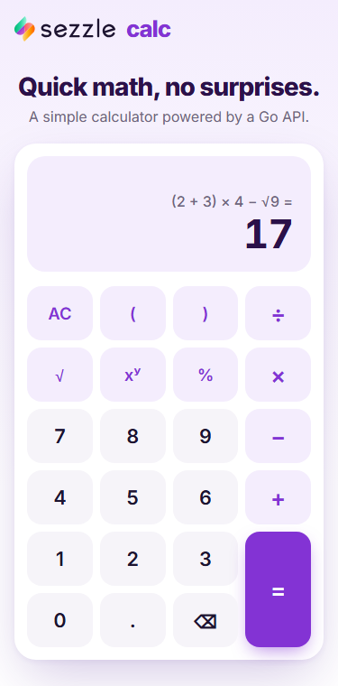

# Full-Stack Calculator

A keypad calculator with a **React + TypeScript** frontend and a **Go** REST API. You can type full expressions such as `(2 + 3) × 4 − √9`. The server evaluates them with standard operator precedence, so `2 + 3 × 4` gives **14**.

<p>
  
  
</p>

- **Operations:** addition, subtraction, multiplication and division, plus exponentiation, square root, percentage and parentheses.
- **Input:** the on-screen keypad or a physical keyboard.
- **Server-side math:** every calculation is done by the Go API. It parses and validates the expression and returns consistent JSON errors.
- **Layout and accessibility:** responsive down to small phones; keys have accessible labels and keyboard shortcuts.
- **Tests:** unit and integration tests on both the backend and the frontend.

---

## Quick start (Docker)

```bash
docker compose up --build
```

| URL | What |
|---|---|
| http://localhost:3000 | The app |
| http://localhost:8080/api/health | The API, also exposed directly for `curl` |

## Local development

**Prerequisites:** Go 1.22+ and Node.js 22.12+.

```bash
# Terminal 1: API on :8080
cd backend
go run ./cmd/server

# Terminal 2: frontend on :5173 (Vite proxies /api to :8080)
cd frontend
npm install
npm run dev
```

Set the `PORT` environment variable to change the API port. If you do, also set `VITE_API_PROXY_TARGET` (for example `http://localhost:9000`) when running `npm run dev`.

### Tests and checks

```bash
cd backend
go vet ./...
go test ./...

cd frontend
npm test -- --run    # Vitest + React Testing Library
npm run lint         # oxlint
npm run build        # type-check + production build
```

---

## Project structure

```
backend/
  cmd/server/main.go               HTTP server setup, timeouts, graceful shutdown
  internal/calculator/
    calculator.go                  Single operations + domain errors (no HTTP)
    expression.go                  Tokenizer + recursive-descent parser for expressions
  internal/api/                    Routing, request validation, error mapping, middleware
frontend/src/
  api/calculatorClient.ts          Typed fetch wrapper; normalizes every failure to ApiError
  calculator/calculatorReducer.ts  Pure state machine that builds expressions from key presses
  calculator/useCalculator.ts      Connects the reducer to the API and the keyboard
  calculator/keyboard.ts           Maps keyboard keys to calculator actions
  components/                      Calculator, Display, Keypad
  utils/format.ts                  Result formatting / float rounding
  messages.ts                       All user-facing text (labels, aria-labels, error messages)
docker-compose.yml                 backend (distroless) + frontend (nginx, proxies /api)
```

---

## API

All errors share one shape. Clients should branch on `code`; `message` is safe to show to users.

```json
{ "error": { "code": "DIVISION_BY_ZERO", "message": "Division by zero is not allowed." } }
```

### `POST /api/v1/evaluate` (used by the UI)

Evaluates an arithmetic expression with standard precedence.

| Field | Type | Required |
|---|---|---|
| `expression` | string, up to 256 characters | yes |

```bash
curl -s -X POST http://localhost:8080/api/v1/evaluate \
  -H 'Content-Type: application/json' \
  -d '{"expression":"2 + 3 * 4"}'
```
```json
{ "result": 14 }
```

```bash
curl -s -X POST http://localhost:8080/api/v1/evaluate \
  -H 'Content-Type: application/json' \
  -d '{"expression":"(2 + 3) * 4 - sqrt(9) + 150 * 20%"}'
```
```json
{ "result": 47 }
```

```bash
curl -s -X POST http://localhost:8080/api/v1/evaluate \
  -H 'Content-Type: application/json' \
  -d '{"expression":"50 + 10%"}'
```
```json
{ "result": 55 }
```

```bash
curl -s -X POST http://localhost:8080/api/v1/evaluate \
  -H 'Content-Type: application/json' \
  -d '{"expression":"2 + )"}'
```
```json
{ "error": { "code": "INVALID_EXPRESSION", "message": "Invalid expression: unexpected \")\" at position 5." } }
```

**Expression syntax**

| Element | Syntax |
|---|---|
| Numbers | `42`, `3.14`, `.5`, `1.5e3` |
| Operators, lowest to highest precedence | `+ -`, then `* /`, then unary `-`, then `^` (right-associative), then postfix `%` |
| Percentage | `x%` is x / 100 (`150 * 20%` = 30). When a percentage is the whole right-hand side of `+` or `-`, it is that percent of the left side, as on iOS: `50 + 10%` = 55, `200 - 10%` = 180. |
| Square root | `sqrt 9`, `sqrt(9 + 7)` or `√9`. It applies to the number or parenthesized group that follows it. |
| Grouping | `( … )` |
| Keypad symbols | `×`, `÷` and `−` are accepted as aliases for `*`, `/` and `-` |

### `POST /api/v1/calculate`

Performs a single operation. It is not used by the UI any more but is kept as a simple, typed API. `/evaluate` uses the same `Calculate` function for every step, so both endpoints follow the same rules.

| Field | Type | Required |
|---|---|---|
| `operation` | `add` \| `subtract` \| `multiply` \| `divide` \| `power` \| `sqrt` \| `percentage` | yes |
| `a` | number | yes |
| `b` | number | for binary operations; ignored by `sqrt` and `percentage` |

`percentage` on its own always returns `a / 100`. The iOS-style "percent of the left side" rule needs the left operand, so it only applies in `/evaluate`.

```bash
curl -s -X POST http://localhost:8080/api/v1/calculate \
  -H 'Content-Type: application/json' \
  -d '{"operation":"divide","a":10,"b":4}'
```
```json
{ "result": 2.5 }
```

```bash
curl -s -X POST http://localhost:8080/api/v1/calculate \
  -H 'Content-Type: application/json' \
  -d '{"operation":"add","a":"1","b":2}'
```
```json
{ "error": { "code": "INVALID_REQUEST", "message": "Field \"a\" must be a number." } }
```

### Error codes

| Status | Code | When |
|---|---|---|
| 400 | `INVALID_REQUEST` | Malformed JSON, unknown fields, wrong types, missing required field, body over 2 KB |
| 400 | `INVALID_EXPRESSION` | Expression syntax error; the message includes the position |
| 400 | `MISSING_OPERAND` | `/calculate`: `a` missing, or `b` missing for a binary operation |
| 400 | `UNSUPPORTED_OPERATION` | `/calculate`: unknown `operation` |
| 422 | `DIVISION_BY_ZERO` | Division by zero |
| 422 | `NEGATIVE_SQUARE_ROOT` | Square root of a negative number |
| 422 | `RESULT_OUT_OF_RANGE` | The result is NaN or ±Infinity (e.g. `10^400`, `0^-1`, `(-8)^0.5`) |
| 404 / 405 | `NOT_FOUND` / `METHOD_NOT_ALLOWED` | Unknown route or wrong HTTP method |
| 500 | `INTERNAL_ERROR` | Unexpected panic (recovered and logged) |

### `GET /api/health`

```json
{ "status": "ok" }
```

---

## Calculator behavior

| Topic | Behavior |
|---|---|
| **Precedence** | Standard math order. `2 + 3 × 4` = 14; `(2 + 3) × 4` = 20; `2 ^ 3 ^ 2` = 512 (`^` is right-associative). |
| **Negative numbers** | `−` acts as a sign at the start of an expression, after `(` and after `×`, `÷` or `^`, as in `2 × −3`. As in standard notation, `−2 ^ 2` = −4; use `(−2) ^ 2` to get 4. |
| **Percentage** | Works like the iOS calculator. After `+` or `−`, `x%` is x percent of the value on its left, so `50 + 10%` = 55 and `200 − 10%` = 180. Anywhere else, `x%` means x / 100, so `150 × 20%` = 30 and `20%` alone is 0.2. |
| **Square root** | Press `√` before or after its operand: `√ 9` and `9 √` both give `√9`. After a parenthesized group or a percentage, it wraps the whole group. A negative operand returns an error. |
| **Input help** | `×` is inserted between adjacent operands (`2(3)` becomes `2 × (3)`). Any open parentheses are closed when you press `=`. Keys that cannot apply at that point are ignored, for example `)` with no open `(` or `×` right after `(`. Pressing an operator right after another replaces it. |
| **After a result** | A digit starts a new expression. An operator, `%` or `√` continues from the result. |
| **Errors** | The message replaces the main display, and the expression stays above it. The next key dismisses the error and continues editing, so you can fix `5 ÷ 0` with backspace instead of retyping it. |
| **Floating point** | The API returns full `float64` results. The display rounds to 12 significant digits, so `0.1 + 0.2` shows `0.3`. Very large or very small values switch to exponential notation. |
| **Limits** | Up to 15 digits per number and 200 characters per expression. The server accepts up to 256. |

### Keyboard shortcuts

| Key | Action |
|---|---|
| `0`–`9`, `.` or `,` | Enter number |
| `+` `-` `*` (or `x`) `/` `^` | Operators (`-` is also the sign) |
| `(` `)` | Parentheses |
| `%` | Percent |
| `R` | Square root |
| `Enter` or `=` | Evaluate |
| `Backspace` | Delete last character |
| `Esc` or `Delete` | Clear |

---

## Design decisions

- **Expressions are evaluated on the server.** The frontend builds the expression and sends it whole. The Go API parses and evaluates it, so the math rules live in one place and are tested once. The alternative was to apply precedence in the browser and call `/calculate` once per operation. That would duplicate the parsing logic and need several round trips for each `=`.
- **A hand-written recursive-descent parser.** The grammar is small: four precedence levels, plus parentheses, `√` and `%`. The parser is about 350 lines with no dependencies, gives precise error positions, and is easy to read and test. It builds an AST before evaluating anything, so a syntax error anywhere is reported before a math error such as division by zero. Evaluating every node through `Calculate` means both endpoints share the same domain rules and errors. Input is limited to 256 characters, which also limits how deep the recursion can go.
- **iOS-style percentages are a parser rule.** When the parser sees `a + b%` or `a - b%`, it rewrites it to `a + a × b%` before evaluating. The rule therefore needs the left operand, and the frontend sends `%` exactly as typed. It only applies when the percentage is the whole right-hand side (`50 + 10% × 2` is 50.2), which keeps the rule predictable.
- **Domain logic is separate from transport.** `internal/calculator` is plain Go that returns sentinel errors (`ErrDivisionByZero`, `ErrInvalidExpression`, …). `internal/api` maps each error to an HTTP status and error code in a single function.
- **Strict request validation.** Both endpoints share one strict JSON decoder that rejects unknown fields, wrong types, trailing data and bodies over 2 KB. In `/calculate`, operands are decoded as `*float64`, so a missing `b` is not mistaken for `b: 0`. NaN and ±Infinity results become a 422 instead of invalid JSON.
- **400 vs 422.** 400 means the request is malformed or cannot be parsed. 422 means it is well-formed but the math is undefined.
- **Go standard library only.** `net/http` from Go 1.22 is enough for three routes. The middleware covers panic recovery and structured request logging (`log/slog`). The server has timeouts and shuts down gracefully on SIGTERM.
- **The keypad is a pure reducer.** `calculatorReducer.ts` turns key presses into API-ready tokens. The input rules (implicit `×`, valid positions for signs, `√` before or after its operand, auto-closing parentheses) prevent most invalid expressions, but the server still validates everything. The reducer has no side effects: pressing `=` sets `state.request`, and the `useCalculator` hook sends it and dispatches the result back. This lets almost all frontend behavior be tested without rendering or mocks.
- **Keyboard and on-screen keys use the same actions.** `keyboard.ts` maps keys to the same reducer actions as the buttons. `preventDefault` stops `Enter` from also clicking whichever button has focus.
- **All user-facing text is in `messages.ts`.** Labels, accessible names, keyboard hints and error messages live in one typed object. A translation is just another object of the same `Messages` type, and a missing key is a compile error. The UI picks error text by the API's `code` rather than showing the server's English `message`, so errors can be translated too.
- **No CORS setup.** The browser always calls `/api/...` on its own origin. Vite's dev proxy forwards it in development, and nginx forwards it in Docker.
- **Minimal dependencies.** No UI kit, state library or CSS framework. The Docker images are a distroless static Go image (non-root, about 10 MB) and nginx serving the built frontend.

## Testing approach

Tests focus on behavior and edge cases rather than coverage numbers.

- **Backend:**
  - `expression_test.go`:
    - precedence, associativity and unary minus (`-2^2`);
    - percentages, including the iOS rule after `+` and `-` (`50 + 10%` = 55, `50 + 10% + 10%` = 60.5) and where it does not apply (`50 + 10% * 2`);
    - square root, number formats and Unicode operators;
    - syntax errors with their positions;
    - checks that syntax errors are reported before math errors.
  - `calculator_test.go`: every single operation, plus division by zero, negative square roots, overflow, `0^-1` and fractional powers of negatives.
  - `handler_test.go`: `httptest` tests of the HTTP contract for both endpoints: status codes, error codes, the shared error shape, strict decoding, the `Allow` header and panic recovery.
- **Frontend (Vitest + React Testing Library):**
  - `calculatorReducer.test.ts`:
    - the expression-building rules: implicit `×`, signs, replacing an operator, `√` before or after its operand, auto-closing parentheses;
    - behavior after a result;
    - fixing an expression after an error.
  - `Calculator.test.tsx`: integration tests that render the real components with only the API client mocked. They cover precedence, parentheses, percentages, server and network errors, and keyboard input, including the focused-button-plus-Enter case.
  - Smaller unit tests for the API client, the number formatter, the key mapping and the error-message lookup.
- **Not included:** snapshot tests, styling tests, and browser end-to-end tests (see below).

## Trade-offs and future work

- **`float64` instead of decimal arithmetic.** This is fine for a general-purpose calculator, and display rounding hides binary floating-point noise. A finance-grade calculator would use a decimal library (e.g. `shopspring/decimal`).
- **No live preview of the result.** A preview while typing would mean calling the API on every key press, with debouncing, or duplicating the parser in TypeScript.
- **No implicit multiplication in the API.** `2(3)` is a syntax error on the server. The keypad inserts the `×` itself.
- **Possible next steps:**
  - Playwright end-to-end tests against the Docker stack
  - CI (GitHub Actions) running both test suites
  - An OpenAPI spec
  - Calculation history
  - Rate limiting if the API were public
